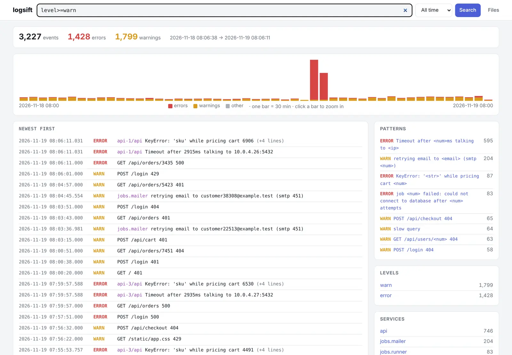
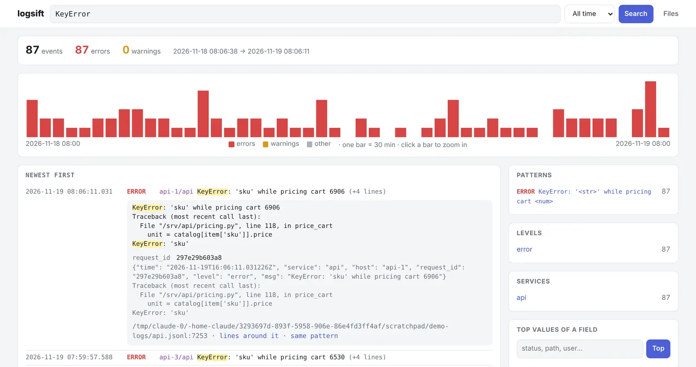
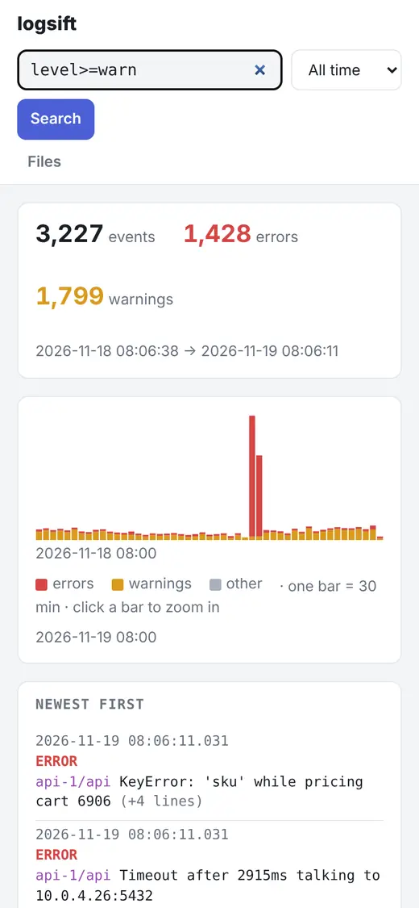

# logsift

**Search and make sense of log files on your own machine.** Point it at your logs, in whatever format they're in, and ask
questions like *"what errors happened in the last hour, and which ones keep happening?"* No server, no agents, no account:
one command and one index file.

```sh
logsift ingest /var/log/nginx ./app/logs
logsift search 'level>=error since:1h'
logsift patterns 'level>=error'          # the distinct problems, biggest first
logsift serve                            # the same, in your browser
```



## Why

When something breaks, the answer is usually in the logs, spread across several files in different formats. `grep`
finds a word but can't say "errors from the API in the last 30 minutes, without the health checks". Hosted log platforms
can, but they cost money, need setting up, and mean shipping your logs to someone else. logsift sits in between: the
questions you'd ask a log platform, answered from files on disk, in about a second.

## What it does

- **Reads most log formats without being told**: JSON lines (including nested Elastic-style fields), logfmt,
  nginx/Apache access logs, syslog (RFC 3164 and 5424), Python/Java/Go-style text logs, and `.gz` rotated files.
  The format is detected per file.
- **Keeps stack traces together**: a Python traceback or Java `at ...` lines become part of the error above them,
  not 30 separate events.
- **Understands timestamps and levels**: ISO 8601 with or without zones, Apache's `19/Nov/2026:07:50:01 +0000`,
  syslog's year-less `Nov 19 07:50:01`, epoch seconds and milliseconds; `WARNING`, `err`, `E`, pino's `50` and syslog
  priorities all become one level scale.
- **Reads only what's new**: ingesting again picks up where it left off. Rotated and truncated files are noticed and
  read from the top; half-written last lines wait until they're complete.
- **A real query language** (below), with full-text search via SQLite FTS5.
- **Patterns**: messages are grouped by shape, with numbers, IPs, UUIDs, ids and emails masked. 600 "Timeout after
  3012ms talking to 10.0.4.17:5432" errors show up as one line with a count. Web requests are grouped by method,
  path and status, so a 404 and a 502 on the same URL stay separate.
- **Timeline, top values and context**: errors and warnings over time, the most common values of any field
  (`top status`, `top path`), and the lines around any event in its own file.
- **A local dashboard** with clickable patterns, a zoomable timeline and expandable events. It's read-only, needs no
  JavaScript, and is served only to your own computer.

## Install

Python 3.10 or newer, and **no dependencies** beyond the standard library.

```sh
git clone https://github.com/zeexduaa/logsift
cd logsift
python -m pip install .
```

Want something to try it on? `python scripts/demo_logs.py demo-logs` writes a day of realistic web, API and worker logs
with an incident in the middle (about 60,000 lines).

## Searching

```
timeout                      words anywhere in the message ("timeout*" for words starting with it)
"connection refused"         an exact phrase
-healthcheck                 leave out events containing a word (works on every kind of term)
level:error   level>=warn    severity: trace debug info warn error fatal
service:api   host:web-1     who logged it (service:api,worker for either)
status>=500   duration>1.5   any field, compared as a number when the value is one
path:/api/*   user:alice     any field; * is a wildcard; nested fields with dots: db.table:orders
source:nginx                 the file it came from (part of the path)
since:1h   until:2026-11-19  a time window: 15m, 2h, 7d, today, yesterday, a date or 2026-11-19T07:50
pattern:"Timeout after <num>ms talking to <ip>"   one group from `logsift patterns`
a OR b   (a OR b) c          either one; brackets group; terms side by side must all match
NOT (level:info OR health)   leave out everything in the brackets (-(...) works too)
```

Terms side by side must all match. `OR`, `AND` and `NOT` are operators only in capitals, so "or" in a message is still
just a word. For example: `(status:502 OR status:504) service:api NOT healthcheck since:1h`. In a terminal, put the search in quotes so the shell doesn't treat `>` as a redirect:
`logsift search 'status>=500 since:1h'`.

## Commands

| Command | What it does |
|---|---|
| `logsift ingest PATHS...` | read files, folders (recursively) or globs; `-` reads from stdin (`kubectl logs pod \| logsift ingest -`) |
| `logsift refresh` | read new lines from every file already in the index (handy in a scheduled task) |
| `logsift search QUERY` | matching events, newest at the bottom; `-n`, `--full` for whole stack traces, `-C 3` for context, `--json`, `--csv` |
| `logsift count QUERY` | how many events match (for scripts and alerts) |
| `logsift stats QUERY` | totals per level and a timeline |
| `logsift top FIELD QUERY` | the most common values of a field |
| `logsift patterns QUERY` | the distinct messages, biggest groups first |
| `logsift serve` | the dashboard at http://127.0.0.1:8800/ |
| `logsift sources`, `forget PATH`, `prune --older-than 30d` | manage what's in the index |

Times without a zone are read as local time; `--tz UTC` (or `--tz +05:00`) changes that and how times are shown.

| A stack trace, kept with its error | On a phone |
|---|---|
|  |  |

## How it works

The index is a single SQLite file (in your cache folder, or `--db FILE` / `LOGSIFT_DB`). Each event is stored with its
time, level, service, host, message, the remaining fields as JSON, and its pattern; an FTS5 index covers the messages.
Searches are compiled to SQL with every value as a bound parameter, so nothing typed in a search can change the
database. In testing, ingesting ran at about 20,000 lines a second, and searches over 90,000 events finished in about a
tenth of a second, including starting up.

| File | What it holds |
|---|---|
| `timeparse.py` | timestamps, durations, zones and levels |
| `parsers.py` | format detection, the parsers, and multi-line events |
| `ingest.py` | reading files incrementally, rotation, gzip, stdin |
| `store.py` | the SQLite schema and full-text index |
| `query.py` | the search language and its compiler |
| `patterns.py` | message templates |
| `analytics.py` | search, counts, timeline, top values, patterns, context |
| `cli.py`, `web.py` | the command line and the dashboard |

## Development

```sh
python -m pip install -e . pytest
python -m pytest
```

Every search in the tests runs twice, with and without SQLite's full-text index, and both must give the same answers.

See [ROADMAP.md](ROADMAP.md) for what's next.

## License

MIT
